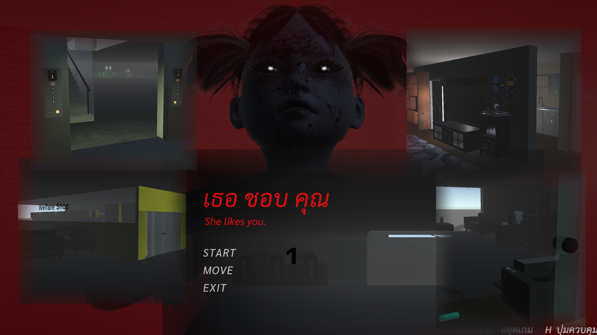

  

<h1 align="center">เธอ ชอบ คุณ (She likes you.)</h1>

  เกมสยองขวัญมุมมองบุคคลที่หนึ่ง พัฒนาด้วย Unity — เล่นได้ทันทีบนเบราว์เซอร์ ทั้งคอมพิวเตอร์และมือถือ 
  <i>A first-person horror game made in Unity — playable in the browser on desktop and mobile.</i>

  <a href="https://mybuildinggame.web.app/"><b>▶ เล่นเลย / Play now</b></a>
  &nbsp;·&nbsp;
  <a href="https://youtu.be/ygsUEgjmWmQ"><b>🎬 วิดีโอเกมเพลย์ / Gameplay video</b></a>
  &nbsp;·&nbsp;
  <a href="#english">English ↓</a>

  
  
  
  
  

---

## 🇹🇭 ภาษาไทย

### เกี่ยวกับเกม

> *เมื่อคุณถูกสั่งให้เข้ามาเก็บของ 
> ในที่ทำงาน ที่ทุกคนกลับหมดแล้ว 
> โดยคุณต้องหาของส่วนตัว 9 ชิ้น 
> และออกไปจากที่นี่*
>
> *แต่!! 
> ระวัง 'เธอ' เอาไว้ให้ดี...*

ผู้เล่นต้องสำรวจที่ทำงานหลายชั้นยามค่ำคืน ใช้ลิฟต์และบันไดเดินทาง ค้นหาของส่วนตัว 9 ชิ้นตามลำดับ แล้วหากุญแจเพื่อออกทางประตู
ระหว่างทางจะมี "เธอ" คอยตามหลอก ทั้งโผล่จากเพดาน คลานไล่ตามบนฝ้า เดินผ่านในความมืด และไล่ล่าเมื่อหยิบของบางชิ้น

### ระบบที่พัฒนาในโปรเจกต์นี้

**เกมเพลย์**
- **ระบบภารกิจ** — เก็บของ 9 ชิ้นตามลำดับ มีข้อความบอกชิ้นต่อไปและความคืบหน้า (x/9) เก็บครบแล้วปลดล็อกทางออกและเข้าสู่ฉากจบ
- **ระบบโต้ตอบ** — ยิง Raycast จากกลางจอ คลิกเพื่อเปิดประตู/กดปุ่ม กดค้างเพื่อถือของ กด E เพื่อเก็บหรือกิน
- **ลิฟต์ที่ทำงานได้จริง** — กดเรียกจากหน้าชั้นหรือกดในห้องลิฟต์ จอแสดงชั้นเปลี่ยนตามความสูงจริง ประตูปิดอัตโนมัติและรอถ้ามีผู้เล่นยืนขวาง
- **ไฟฉาย** ที่หันตามมุมกล้อง

**AI ผีและการหลอก**
- **ผีไล่ล่า** — เริ่มไล่เมื่อหยิบกุญแจ มีจุดเริ่ม จุดหนีถึงเส้นชัย และฉากโดนจับ (กล้องสั่น, เปลี่ยนแอนิเมชัน, ผีพุ่งเข้าหน้ากล้อง)
- **ผีคลานบนเพดาน** — ล็อกความสูงติดฝ้าและหันหน้าแบบห้อยหัว (ใช้ `Quaternion.LookRotation` โดยกำหนดทิศ up เป็น `Vector3.down`)
- **ผีห้อยหัวจากเพดาน** — พุ่งทะลุฝ้าลงมาจ้องหน้าผู้เล่นแล้วกระชากกลับ
- **"เธอ" โผล่ข้างหลังแบบสุ่ม** — เช็กว่าตำแหน่งที่จะโผล่มองเห็นได้ (ไม่มีผนังบัง) อยู่ชั้นเดียวกันและมีพื้นที่ว่าง เธอจะหายไปทันทีที่ผู้เล่นหันมาเห็น
- **ScareFX** — ระบบเอฟเฟกต์กลางที่ผีทุกตัวใช้ร่วมกัน ได้แก่ จอสั่น ขอบจอแดง ไฟกะพริบ และ "ความเงียบก่อนผีโผล่"

**เสียงและบรรยากาศ**
- **AmbienceManager** — เสียงหลอนวนตลอดเกม และสุ่มเสียงเล็กๆ จากด้านหลังผู้เล่น (เสียง 3D) ความถี่และความดังเพิ่มขึ้นตามความคืบหน้าของภารกิจ

**UI และรองรับหลายแพลตฟอร์ม**
- **เมนูทั้งหมดสร้างด้วยโค้ด** — เมนูหลัก (START / MOVE / EXIT), เมนูหยุดเกม, ป้ายปุ่มควบคุม และไอคอนคีย์บอร์ด/เมาส์ที่วาดเองด้วยโค้ด (`UIIconFactory`) ไม่ใช้ไฟล์รูป
- **รองรับมือถือ** — จอยสติ๊กลอยฝั่งซ้าย ลากนิ้วฝั่งขวาเพื่อมอง และปุ่มต่างๆ บนจอ ความไวคำนวณตามความสูงจอเพื่อให้เท่ากันทุกขนาดหน้าจอ
- **แสดงภาษาไทยถูกต้อง** — แก้ปัญหาสระบน/ล่างและวรรณยุกต์ซ้อนกัน พร้อมข้อความ Intro แบบพิมพ์ดีดทีละตัว

**เครื่องมือใน Unity Editor (Editor Tools)**
- `Tools > Optimize Textures for Web` — ลดขนาด texture เฉพาะตอน build WebGL (ไม่แก้ไฟล์ต้นฉบับ ย้อนกลับได้)
- `Tools > Setup Ambience` / `Setup She Appears` — สร้างระบบในฉากพร้อมใส่ไฟล์เสียงและโมเดลให้อัตโนมัติ
- `Tools > Replace Audio Clip` / `Spatial Blend Fixer` — แก้ AudioSource หลายตัวพร้อมกัน (รองรับ Undo)

### การปรับให้เล่นบนเว็บได้ลื่น
- ลดขนาด build จาก **~440 MB เหลือ ~160 MB** ด้วยการเปิดบีบอัด Gzip และจำกัดขนาด texture สำหรับ WebGL (198 ไฟล์)
- ทำหน้าเว็บ (WebGL Template) เอง พร้อมหน้าแจ้งเตือนสำหรับผู้เล่นบนมือถือก่อนโหลดเกม
- Deploy ขึ้น Firebase Hosting

### วิธีเล่น

| การกระทำ | คอมพิวเตอร์ | มือถือ |
|---|---|---|
| เดิน / วิ่ง | `W A S D` / `Shift` | จอยซ้าย (ดันสุด = วิ่ง) |
| มองรอบตัว | เมาส์ | ลากนิ้วฝั่งขวา |
| กระโดด | `Space` | ปุ่มกระโดด |
| เปิดประตู / กดปุ่ม | คลิกซ้าย | แตะ |
| ถือของ | กดคลิกซ้ายค้าง | กดค้าง |
| เก็บของ / กิน | `E` | ปุ่มเก็บ |
| ไฟฉาย | `L` | ปุ่มไฟฉาย |
| ป้ายปุ่มควบคุม / หยุดเกม | `H` / `ESC` | ปุ่ม II |

### เทคโนโลยีที่ใช้
Unity 6 · C# · Universal Render Pipeline (URP) · Cinemachine · Input System · WebGL · Firebase Hosting · Git + Git LFS

### โครงสร้างโค้ด
สคริปต์ที่เขียนสำหรับเกมนี้อยู่ใน [`Scripts/`](Scripts/) (ส่วน Editor Tools อยู่ใน [`Scripts/Editor/`](Scripts/Editor/))

| ไฟล์ | หน้าที่ |
|---|---|
| `GameManager.cs` | สถานะเกม, ภารกิจ, Intro, ฉากจบ |
| `GameMenuUI.cs`, `UIIconFactory.cs` | เมนูและ UI ที่สร้างด้วยโค้ด |
| `PlayerInteractor.cs`, `InteractableProp.cs` | การโต้ตอบกับวัตถุ |
| `ElevatorController.cs`, `ElevatorButton.cs`, `ElevatorDisplay.cs` | ระบบลิฟต์ |
| `ChaseStartTrigger.cs`, `GhostCeilingChase.cs`, `GhostHangTrigger.cs`, `GhostWalkBy.cs`, `SheAppears.cs` | ผีและเหตุการณ์หลอก |
| `ScareFX.cs`, `AmbienceManager.cs` | เอฟเฟกต์และเสียงบรรยากาศ |
| `MobileControls.cs`, `MobileInput.cs` | ปุ่มควบคุมบนมือถือ |

### เครดิต
โมเดล 3D, texture, เสียง และฟอนต์ ใช้ asset จากผู้สร้างภายนอก (เช่น Unity Asset Store) ลิขสิทธิ์เป็นของเจ้าของแต่ละราย
ส่วนการออกแบบเกม ฉาก ระบบเกมเพลย์ และโค้ด C# ใน `Scripts/` เป็นงานของโปรเจกต์นี้

---

## 🇬🇧 English

### About the game

> *You've been told to come back and collect your things 
> from the workplace, after everyone else has gone home. 
> You must find your 9 personal belongings 
> and get out of here.*
>
> *But!! 
> Watch out for "her"...*

Explore your multi-floor workplace at night, using a working elevator and the stairs. Find your 9 belongings in order, grab the key and get out through the exit.
Along the way, "she" haunts you: dropping from the ceiling, crawling after you across it, walking past in the dark, and chasing you down when you pick up certain items.

### Features built in this project

**Gameplay**
- **Mission system** — collect 9 items in sequence, with next-item prompts and an x/9 progress counter. Collecting everything unlocks the exit and triggers the ending.
- **Interaction system** — raycast from the screen center: click to open doors or press buttons, hold to carry objects, press E to pick up or eat.
- **Working elevator** — call it from any floor or use the cabin panel. The floor display follows the cabin's real height, and the doors close automatically but wait while the player stands in the way.
- **Flashlight** that follows the camera direction.

**Ghost AI & scares**
- **Chase sequence** — triggered by picking up the key, with a start point, a finish line to escape to, and a caught sequence (camera shake, animation switch, ghost lunging at the camera).
- **Ceiling crawler** — locked to the ceiling height and rotated upside-down toward the player (`Quaternion.LookRotation` with `Vector3.down` as the up vector).
- **Ceiling drop** — bursts through the ceiling, hangs face-to-face with the player, then snaps back up.
- **"She appears" behind you** — picks a random spawn behind the player that is in line of sight (no walls), on the same floor and has free space. She vanishes the moment the player turns to look.
- **ScareFX** — one shared effects system used by every ghost: screen shake, red vignette, light flicker and a "silence before the scare".

**Audio & atmosphere**
- **AmbienceManager** — a looping ambient track plus random 3D sounds from behind the player. Volume and frequency rise as the mission progresses.

**UI & multi-platform support**
- **All menus built from code** — main menu (START / MOVE / EXIT), pause menu, controls panel and keyboard/mouse icons drawn procedurally (`UIIconFactory`), with no image files.
- **Mobile support** — floating joystick on the left, drag-to-look on the right and on-screen action buttons. Look sensitivity is scaled by screen height so it feels the same on every device.
- **Correct Thai text rendering** — fixes stacked Thai vowels and tone marks, plus a typewriter-style intro.

**Unity Editor tools**
- `Tools > Optimize Textures for Web` — caps texture sizes for WebGL builds only (source files untouched, fully reversible).
- `Tools > Setup Ambience` / `Setup She Appears` — one-click scene setup that assigns sounds and models automatically.
- `Tools > Replace Audio Clip` / `Spatial Blend Fixer` — batch-edit AudioSources in the open scene (with Undo).

### Web optimization
- Cut the build from **~440 MB to ~160 MB** with Gzip compression and WebGL-specific texture limits (198 textures).
- Custom WebGL template with a notice screen for mobile players before loading.
- Deployed on Firebase Hosting.

### Controls

| Action | Desktop | Mobile |
|---|---|---|
| Move / Run | `W A S D` / `Shift` | Left joystick (push fully = run) |
| Look | Mouse | Drag on the right side |
| Jump | `Space` | Jump button |
| Open door / Press button | Left click | Tap |
| Carry object | Hold left click | Hold |
| Pick up / Eat | `E` | Pick-up button |
| Flashlight | `L` | Flashlight button |
| Controls panel / Pause | `H` / `ESC` | II button |

### Tech stack
Unity 6 · C# · Universal Render Pipeline (URP) · Cinemachine · Input System · WebGL · Firebase Hosting · Git + Git LFS

### Code overview
The gameplay scripts are in [`Scripts/`](Scripts/), and the Editor tools are in [`Scripts/Editor/`](Scripts/Editor/).

| File | Purpose |
|---|---|
| `GameManager.cs` | Game state, mission, intro, ending |
| `GameMenuUI.cs`, `UIIconFactory.cs` | Code-built menus and UI |
| `PlayerInteractor.cs`, `InteractableProp.cs` | Object interaction |
| `ElevatorController.cs`, `ElevatorButton.cs`, `ElevatorDisplay.cs` | Elevator system |
| `ChaseStartTrigger.cs`, `GhostCeilingChase.cs`, `GhostHangTrigger.cs`, `GhostWalkBy.cs`, `SheAppears.cs` | Ghosts and scare events |
| `ScareFX.cs`, `AmbienceManager.cs` | Effects and ambient audio |
| `MobileControls.cs`, `MobileInput.cs` | Mobile on-screen controls |

### Credits
3D models, textures, sounds and fonts come from third-party creators (e.g. the Unity Asset Store) and remain the property of their respective owners.
The game design, level design, gameplay systems and C# code in `Scripts/` are original work for this project.
